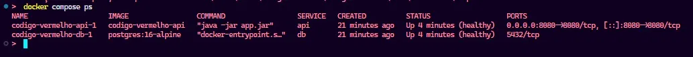
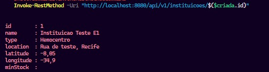
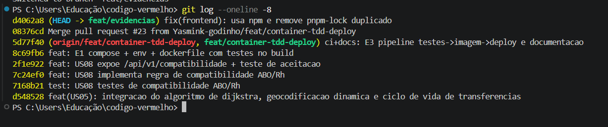
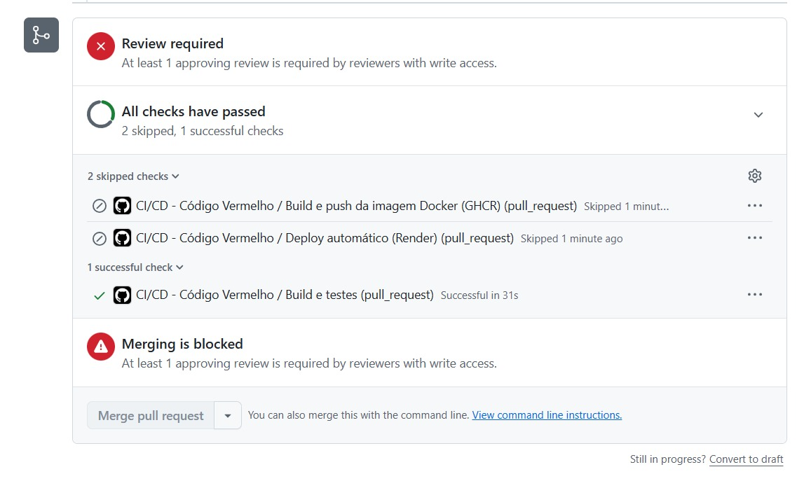
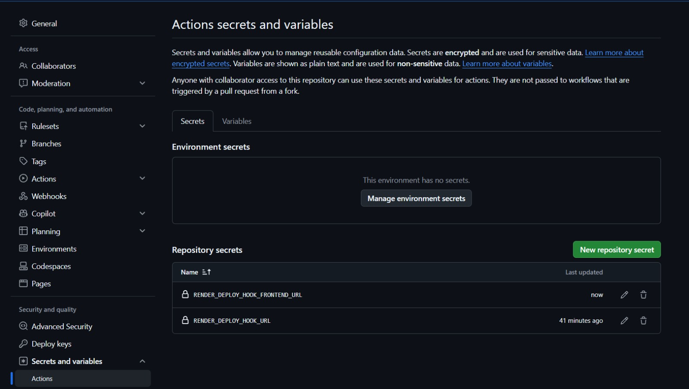
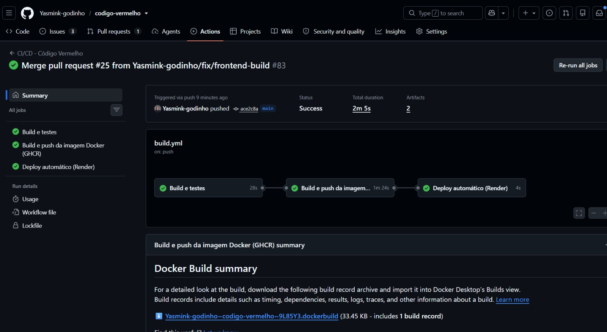
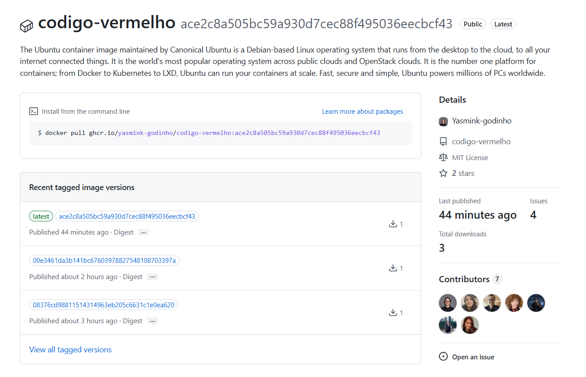
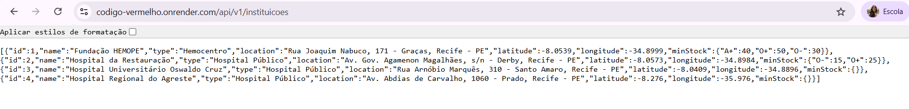
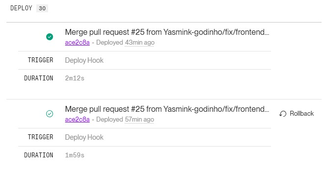
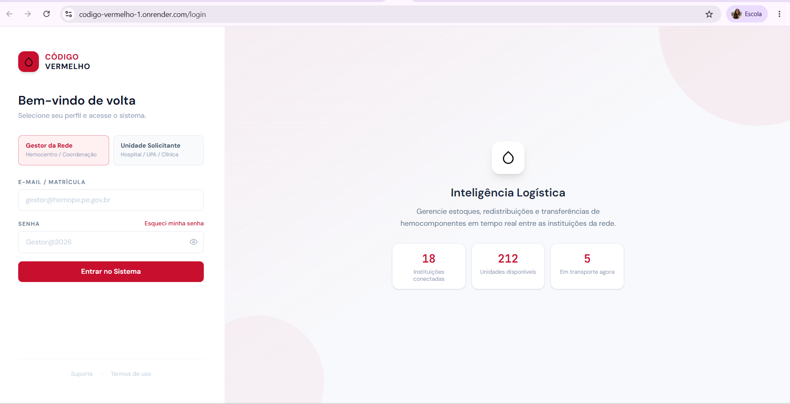

# Entrega — Container, TDD e Deploy automatizados

> Documento da entrega da Unidade 2 (Infraestrutura de Software). Reúne as
> seções exigidas, a tabela de decisões, o uso de IA e as evidências.

## Integrantes
- Larissa Morais
- João Rafael Morato
- Yasmin Godinho
- Diogo Alcelino
- Thayná Verçosa
- Isabela Karla
- Kezia Aguiar

## Como rodar (do zero, com um comando)

```bash
cp .env.example .env            # ajuste a senha do banco
docker compose up -d --build    # sobe API + Postgres
docker compose ps               # api e db devem ficar "healthy"
```

A API fica em `http://localhost:8080`. Exemplo:

```bash
curl "http://localhost:8080/api/v1/compatibilidade?doador=O-&receptor=AB%2B"
```

Para derrubar: `docker compose down` (os dados ficam no volume `pgdata`) ou
`docker compose down -v` (apaga também os dados).

Frontend (opcional, local): `cd frontend && npm install && npm run dev`
(usa `VITE_API_BASE_URL`, padrão `http://localhost:8080/api/v1`).

## Testes

```bash
cd backend && ./mvnw verify      # roda toda a suíte
```

| Nível | Arquivo |
|---|---|
| Unitário | `CompatibilidadeSanguineaTest`, `ScoreRiscoServiceTest`, `DijkstraTest` |
| Integração (banco) | `FilaFefoIntegracaoTest` |
| Aceitação (HTTP) | `CompatibilidadeHttpTest`, `RotasETelemetriaHttpTest` |
| BDD (Gherkin) | `backend/src/test/resources/features/compatibilidade.feature` |

Story map, qual regra ganhou teste primeiro e o histórico red → green:
**`docs/infraestrutura_software/STORY_MAP_E_TDD.md`**.

## Pipeline e deploy

`.github/workflows/build.yml`: **testes → imagem → deploy**.
- `testes` roda em PR e na main; é o gate (PR vermelho não mergeia).
- `imagem` e `deploy` só rodam em push na main, depois do gate verde.
- Imagem publicada no GHCR; deploy no Render (**dois serviços**: backend Web Service + frontend Static Site) via Deploy Hook, só com a esteira verde.

URLs públicas: ⚠️ backend `https://codigo-vermelho.onrender.com` · frontend `https://codigo-vermelho-1.onrender.com`

Setup dos dois serviços + Postgres + profiles: **`docs/infraestrutura_software/RENDER_SETUP.md`**.
Fluxo de branch, main protegida, segredos e **rollback**: **`docs/infraestrutura_software/PIPELINE_E_DEPLOY.md`**.

## Decisões

| Decisão | Opções | Escolha e porquê |
|---|---|---|
| Imagem base | `temurin:21-jdk`/`21-jre`, `-alpine`, `-slim` | **JDK no build, JRE no runtime** (multi-stage): a imagem final não carrega o JDK nem o Maven (menor e com menos pacotes vulneráveis). |
| Multi-stage | estágio único vs. multi-stage | **Multi-stage**: compila e **roda os testes** no 1º estágio; o 2º leva só o `.jar`. |
| Dados | H2, PostgreSQL; bind mount vs. volume | **PostgreSQL em volume nomeado** (`pgdata`): os dados sobrevivem ao `docker compose down`. |
| Rede | ports vs. rede do Compose | **Rede do Compose**: a API acha o banco pelo nome do serviço `db`; só a porta da API é exposta no host. |
| Healthcheck | sem / TCP / HTTP | **HTTP** (`curl` em `/api/v1/instituicoes`) na API e `pg_isready` no banco; `depends_on: service_healthy`. |
| Qual regra testar 1º | — | **Compatibilidade ABO/Rh**: um erro aqui põe um paciente em risco. |
| Fluxo de branch | Git Flow, GitHub Flow, GitLab Flow | **GitHub Flow**: grupo pequeno, uma versão no ar, deploy a cada merge. |
| CI/CD e deploy | GitHub Actions, GitLab CI; Render, Railway, Fly.io | **Actions** (o código já está no GitHub) + **Render** (free). |
| Arquitetura de deploy | serviço único vs. serviços separados | **Dois serviços** no mesmo repo: Web Service (backend/Docker) + Static Site (frontend) — mais estável e cada um escala/deploya sozinho. |
| Profile em produção | dev (H2) vs. prod (Postgres) | **prod + PostgreSQL** (`SPRING_PROFILES_ACTIVE=prod`); dev/test usam H2. |
| Segredos | `.env`, secrets da ferramenta | **GitHub Secrets** (`RENDER_DEPLOY_HOOK_URL`, `RENDER_DEPLOY_HOOK_FRONTEND_URL`); `DB_*` e `APP_CORS_ALLOWED_ORIGINS` no painel do Render; `.env` no `.gitignore`, só `.env.example` versionado. |

## Uso de IA

Permitido e declarado. A IA **rascunhou** os testes e o esqueleto da regra US08,
o `compose.yaml`, o `Dockerfile` e o workflow; o grupo **validou e assinou**
(a tabela ABO/Rh foi conferida à mão).

Prompts principais:
- "Implemente a regra de compatibilidade ABO/Rh para concentrado de hemácias, começando pelos testes (TDD)."
- "Crie um compose.yaml com API Spring Boot + Postgres, volume, healthcheck e depends_on."
- "Monte um pipeline GitHub Actions: testes como gate, build e push de imagem no GHCR, deploy no Render só na main."

## Evidências

### E1 — Container
- [x] Containers `api` e `db` **healthy** (API + Postgres sobem com `docker compose up -d --build`):


- [x] API respondendo (criou e leu uma instituição do Postgres):


### E2 — TDD
- [x] **Commit do teste antes do código (red → green).** O histórico mostra `7168b21 test: US08...` seguido de `7c24ef0 feat: US08...` — o teste nasceu antes da implementação:


- [x] **Suíte de testes verde na esteira + merge bloqueado sem aprovação.** O job `Build e testes` passou (Successful in 31s); os jobs `imagem` e `deploy` aparecem como *Skipped* porque só rodam em push na main; e o merge fica bloqueado exigindo 1 revisão (main protegida):


### E3 — Deploy
- [x] Segredos (deploy hooks dos dois serviços) guardados no GitHub Secrets, fora do código:


- [x] Esteira verde publicando: os três estágios **testes → imagem → deploy** passaram na main:


- [x] Imagem publicada no GHCR, versionada por commit (tags `latest` e SHA):


- [x] Backend público no ar respondendo (Render):


- [x] Rollback disponível: voltar a um deploy anterior pelo botão *Rollback* do Render:


- [x] Merge barrado pela proteção da main (exige revisão aprovada e checks verdes). Os jobs `imagem` e `deploy` ficam *skipped* em PR — só rodam após o merge:


- [x] Frontend público no ar (Render Static Site):
