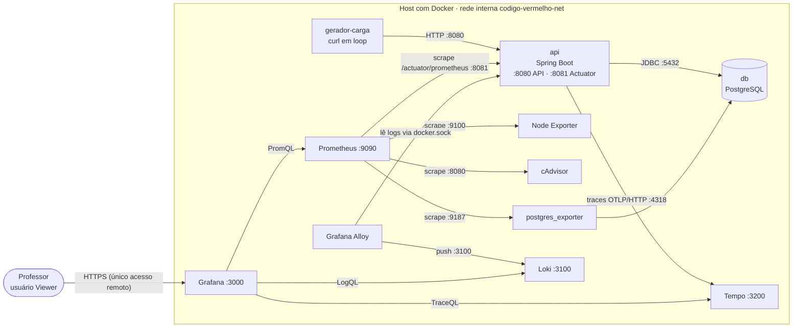

# Observabilidade do Código Vermelho

**Disciplina:** Infraestrutura de Comunicação (RSD) · **Atividade:** Projeto de Avaliação, Observabilidade com Actuator, Prometheus e Grafana
**Aplicação instrumentada:** `backend/` (Spring Boot 4.1.1, Java 17). É a única aplicação web Java do Projeto Integrador; o `frontend/` é React e fica fora dos requisitos.

Este documento é o passo a passo para subir, conferir e apresentar o ambiente. Tudo sobe com **um único comando** a partir da raiz do repositório.

---

## 1. O que foi feito

| Sinal | Ferramenta | Como chega lá |
|---|---|---|
| Métricas da aplicação (HTTP, JVM, CPU, uptime, HikariCP) | Spring Boot Actuator + Micrometer | Prometheus lê `/actuator/prometheus` a cada 15 s |
| Métricas de negócio (requisições, transferências, alertas térmicos, rotas) | Micrometer (código próprio) | mesmo endpoint acima |
| Métricas do host | Node Exporter | Prometheus lê `node-exporter:9100` |
| Métricas dos contêineres | cAdvisor | Prometheus lê `cadvisor:8080` |
| Métricas do banco (opcional do R3) | postgres_exporter | Prometheus lê `postgres-exporter:9187` |
| Logs | Grafana Alloy → Loki | Alloy lê o stdout dos contêineres pelo socket do Docker |
| Traces | OpenTelemetry (OTLP) → Tempo | a aplicação envia cada trace para `tempo:4318` |
| Visualização | Grafana | datasources e dashboards provisionados automaticamente |

## 2. Arquitetura



| Serviço | Imagem | Porta interna | Publicada no host? |
|---|---|---|---|
| `api` | build de `backend/` | 8080 (API), **8081 (Actuator)** | 8080 sim · **8081 não** |
| `db` | `postgres:16-alpine` | 5432 | não |
| `prometheus` | `prom/prometheus:v2.54.1` | 9090 | só em `127.0.0.1:9090` |
| `grafana` | `grafana/grafana:11.2.0` | 3000 | sim (3000), é o único exposto no acesso remoto |
| `node-exporter` | `prom/node-exporter:v1.8.2` | 9100 | não |
| `cadvisor` | `gcr.io/cadvisor/cadvisor:v0.49.1` | 8080 | não |
| `postgres-exporter` | `prometheuscommunity/postgres-exporter:v0.15.0` | 9187 | não |
| `loki` | `grafana/loki:3.3.2` | 3100 | não |
| `alloy` | `grafana/alloy:v1.5.1` | 12345 | não |
| `tempo` | `grafana/tempo:2.6.1` | 3200, 4317, 4318 | não |
| `gerador-carga` | `curlimages/curl:8.11.1` | n/a | não |
| `cloudflared` (perfil `remoto`) | `cloudflare/cloudflared` | n/a | não (sai para a internet) |

O diagrama acima pode ser usado como base do diagrama do PDF (o GitHub renderiza o Mermaid direto na página).

## 3. Pré-requisitos

- Docker e Docker Compose v2 (`docker compose version`).
- Portas livres no host: 8080, 3000 e 9090.
- Uns 3 GB de RAM livres para o conjunto todo.

## 4. Subir o ambiente

```bash
cp .env.example .env          # depois edite o .env e troque TODAS as senhas
docker compose up -d --build  # sobe aplicação + banco + toda a observabilidade
docker compose ps             # todos os serviços devem estar "running" (api e db "healthy")
```

A primeira subida demora alguns minutos (build do Maven + download das imagens). O `gerador-carga` só começa quando a API fica saudável e, a partir daí, gera tráfego sozinho a cada 2 s.

| O quê | Endereço | Observação |
|---|---|---|
| API | http://localhost:8080/api/v1/instituicoes | API pública do sistema |
| Grafana | http://localhost:3000 | login com `GRAFANA_ADMIN_USER` / `GRAFANA_ADMIN_PASSWORD` do `.env` |
| Prometheus | http://localhost:9090/targets | só abre na própria máquina |
| Actuator | sem URL no host | só pela rede interna, ver E1 abaixo |

Para desligar: `docker compose down` (mantém os dados) ou `docker compose down -v` (apaga tudo).

**Só a aplicação, para o dia a dia de desenvolvimento** (sem a stack de observabilidade, bem mais leve):

```bash
docker compose up -d db api
```

## 5. Como conferir cada etapa (e o que printar para o PDF)

> Os prints precisam ter **data e hora visíveis** (relógio do sistema na barra de tarefas ou o seletor de tempo do Grafana).

### E1 · Instrumentação com Actuator

O Actuator não é alcançável de fora (requisito R5), então a evidência é tirada **de dentro** do contêiner:

```bash
# métricas com a tag application
docker compose exec api curl -s http://localhost:8081/actuator/prometheus | grep 'application="codigo-vermelho"' | head -20

# métricas de negócio
docker compose exec api curl -s http://localhost:8081/actuator/prometheus | grep codigovermelho_

# pool de conexões
docker compose exec api curl -s http://localhost:8081/actuator/prometheus | grep hikaricp_connections

# health e info
docker compose exec api curl -s http://localhost:8081/actuator/health
docker compose exec api curl -s http://localhost:8081/actuator/info

# prova de que o Actuator NAO está exposto no host (deve falhar)
curl -s --max-time 3 http://localhost:8081/actuator/prometheus || echo "Actuator fechado para fora, como esperado"
```

### E2 e E3 · Exporters e stack de coleta

- http://localhost:9090/targets: todos os jobs em **UP** (`prometheus`, `codigo-vermelho`, `node-exporter`, `cadvisor`, `postgres-exporter`, `loki`, `tempo`, `alloy`, `grafana`).
- `docker compose ps` mostrando todos os serviços.
- Uma consulta PromQL no Prometheus (aba *Graph*), por exemplo:

```promql
sum by (uri) (rate(http_server_requests_seconds_count{application="codigo-vermelho"}[1m]))
```

### E4 · Dashboards

No Grafana, pasta **Código Vermelho**:

- **Código Vermelho · Aplicação**: visão geral, HTTP (req/s por rota, p95/p99, status, erros), JVM (heap, GC, threads, CPU, uptime), pool HikariCP, métricas de negócio e logs.
- **Código Vermelho · Infraestrutura**: status de todos os targets, host (CPU, memória, disco, rede, load average), contêineres (CPU, memória, rede) e PostgreSQL.

Os JSON ficam em `grafana/dashboards/`. Se alguém editar um painel pela interface, exporte o JSON (*Share → Export → Save to file*) e substitua o arquivo para versionar a mudança.

Como ponto de partida também dá para importar os dashboards públicos **4701** (JVM Micrometer), **1860** (Node Exporter Full) e **14282** (cAdvisor) em *Dashboards → New → Import*.

### E5 · Logs no Loki

Em *Explore*, escolha o datasource **Loki**:

```logql
{application="codigo-vermelho"}                         # todos os logs da aplicação
{application="codigo-vermelho", level="ERROR"}          # só erros
{application="codigo-vermelho"} |= "Alerta termico"     # eventos de negócio
sum by (level) (count_over_time({application="codigo-vermelho"}[5m]))
{service=~"db|prometheus|grafana"}                       # logs dos outros contêineres
```

### E6 · Traces no Tempo e correlação log → trace

1. *Explore* → **Tempo** → aba *Search*, `Service Name = codigo-vermelho`.
2. Abra um trace de `POST /api/v1/transferencias`. Ele tem vários spans: requisição HTTP → `criacao-transferencia` → `calculo-rota`.
3. **Log → trace:** no Explore do Loki, rode `{application="codigo-vermelho"} |= "Transferencia criada"`, clique na linha e depois no botão **Abrir trace no Tempo** (vem do `trace_id=` que aparece em toda linha de log).
4. **Trace → log:** dentro do trace, clique em um span e em *Logs for this span*.
5. **Caso de erro:** `{application="codigo-vermelho", level="ERROR"} |= "Erro simulado"` → abrir o trace, que aparece com status de erro.

Print: um trace aberto com os spans e a navegação a partir da linha de log.

### E7 · Acesso remoto

Ver a seção 7.

## 6. Métricas de negócio (ponto adicional)

Implementadas em `backend/src/main/java/com/codigovermelho/observabilidade/MetricasNegocio.java` e testadas em `MetricasNegocioTest`.

| Métrica no Prometheus | Tipo | O que mede | Onde é registrada |
|---|---|---|---|
| `codigovermelho_requisicoes_emitidas_total` | Counter | Requisições de hemocomponente emitidas, por `tipo_sanguineo`, `componente` e `urgencia` | `RequisicaoService.emitir` (US04) |
| `codigovermelho_requisicoes_pendentes` | Gauge | Requisições com status PENDENTE no banco, lido a cada scrape | consulta `countByStatus` |
| `codigovermelho_transferencias_criadas_total` | Counter | Transferências criadas entre instituições, por `componente` | `TransferenciaService.criar` |
| `codigovermelho_alertas_termicos_total` | Counter | Leituras de temperatura fora de 2 a 6 °C no transporte, por `lado` (acima/abaixo) | `TelemetriaService.registrarLeitura` (US07) |
| `codigovermelho_rota_calculo_seconds_*` | Timer (com histograma) | Tempo do cálculo de rota pelo Dijkstra; também vira o span `calculo-rota` | `RotaService.calcularRota` (US05) |
| `codigovermelho_transferencia_criacao_seconds_*` | Timer | Tempo da criação completa de uma transferência (validação, rota e estoque); também vira o span `criacao-transferencia` | `TransferenciaService.criar` |

Todas aparecem no painel **Métricas de negócio** do dashboard de aplicação.

## 7. Acesso remoto

Regras: expor **apenas o Grafana**, criar um usuário **Viewer** para o professor e informar URL, usuário e período **só no PDF / Google Classroom**.

### 7.1 Criar o usuário Viewer

Preencha `VIEWER_LOGIN` e `VIEWER_PASSWORD` no `.env` e rode, com o ambiente no ar:

```bash
sh scripts/criar-usuario-viewer.sh
```

O script cria o usuário pela API do Grafana. Novos usuários entram como Viewer (`GF_USERS_AUTO_ASSIGN_ORG_ROLE=Viewer`) e o cadastro público está desligado (`GF_USERS_ALLOW_SIGN_UP=false`).

### 7.2 Opção A: Cloudflare Tunnel (mais rápido, gratuito)

```bash
docker compose --profile remoto up -d
docker compose logs cloudflared | grep trycloudflare.com    # copie a URL https://....trycloudflare.com
```

Depois coloque essa URL em `GRAFANA_ROOT_URL` no `.env` e recrie só o Grafana (`docker compose up -d grafana`), senão o login pode redirecionar para `localhost`. Atenção: a URL rápida muda sempre que o contêiner `cloudflared` reinicia e só funciona enquanto a máquina estiver ligada. Para a janela de correção, deixe a máquina ligada e sem suspensão, ou use a opção B.

### 7.3 Opção B: VM gratuita na nuvem (mais estável)

1. Criar uma VM Linux (Oracle Cloud Always Free, AWS/GCP/Azure com créditos estudantis).
2. Instalar Docker, clonar o repositório, criar o `.env` e rodar `docker compose up -d --build`.
3. No firewall / security group liberar **somente a porta 3000** (nunca 8081 nem 9090).
4. `GRAFANA_ROOT_URL=http://IP-DA-VM:3000` no `.env`.

Em VM Linux o Node Exporter e o cAdvisor medem a máquina de verdade.

### 7.4 Opção C: Tailscale

O professor entra na rede privada da equipe por convite e acessa `http://IP-TAILSCALE:3000`. Nada fica público na internet.

## 8. Segurança mínima (R5)

- `/actuator/**` roda na porta **8081**, que não é publicada no host; só o Prometheus a alcança pela rede interna do Docker.
- Prometheus publicado apenas em `127.0.0.1`.
- Senha do Grafana obrigatória pelo `.env`: sem `GRAFANA_ADMIN_PASSWORD` o `docker compose` nem sobe. O `.env` está no `.gitignore`; no repositório só existe o `.env.example`, sem segredos reais.
- Cadastro público e acesso anônimo do Grafana desligados.
- O endpoint de erro simulado só existe quando `APP_OBSERVABILIDADE_ENDPOINT_ERRO_HABILITADO=true` (ligado no compose, desligado no deploy do Render).
- A exportação de traces também só liga no compose; o deploy do Render continua funcionando como antes.

## 9. Diferenças em relação ao exemplo do enunciado

- **Spring Boot 4.1.1** (o exemplo usa 3.3.5). No Boot 4 o tracing usa o starter `spring-boot-starter-opentelemetry`, que substitui as dependências `micrometer-tracing-bridge-otel` + `opentelemetry-exporter-otlp` do Boot 3. O registry de métricas OTLP desse starter foi excluído no `pom.xml`, porque as métricas são coletadas pelo Prometheus.
- **Porta de gerenciamento separada** (`management.server.port=8081`) em vez de esconder o Actuator atrás de autenticação.
- **Logs coletados pelo Grafana Alloy** a partir do stdout dos contêineres, sem biblioteca extra na aplicação. O `traceId` entra em cada linha pelo `logging.pattern.correlation`.
- Arquivo do compose se chama `compose.yaml` (nome padrão atual do Docker Compose, já usado pela equipe); funciona igual ao `docker-compose.yml`.
- A stack de métricas continua sendo **Prometheus + Grafana**, então não é preciso justificar troca de stack no PDF.

## 10. Docker Desktop (Windows/macOS)

No Docker Desktop o Node Exporter e o cAdvisor medem a **VM do Docker**, não o seu computador. O enunciado aceita isso, desde que seja explicado no PDF. Se o cAdvisor não subir no Windows por causa do `/dev/kmsg` ou de `/var/lib/docker`, comente essas linhas no `compose.yaml` e registre isso nas dificuldades.

## 11. Problemas comuns

| Sintoma | O que verificar |
|---|---|
| `required variable GRAFANA_ADMIN_PASSWORD is missing` | Falta criar o `.env` (`cp .env.example .env`) |
| Target `codigo-vermelho` DOWN | `docker compose logs api`; a API pode ainda estar subindo (até 1 min) |
| Nenhum trace no Tempo | `docker compose logs tempo`; e se `MANAGEMENT_TRACING_EXPORT_ENABLED` e `MANAGEMENT_OPENTELEMETRY_TRACING_EXPORT_OTLP_ENDPOINT` estão no serviço `api` |
| Nenhum log no Loki | `docker compose logs alloy`; o Alloy precisa do `/var/run/docker.sock` |
| Dashboards sem dados de negócio | Conferir se o `gerador-carga` está rodando (`docker compose logs gerador-carga`) |
| Login do Grafana volta para `localhost` no acesso remoto | Ajustar `GRAFANA_ROOT_URL` e rodar `docker compose up -d grafana` |
| Erro de permissão no Tempo | O serviço já roda com `user: "0"`; apague o volume com `docker compose down -v` e suba de novo |

## 12. Versão avaliada

A entrega fica no repositório do Projeto Integrador. Depois do merge do PR de observabilidade, a versão avaliada é marcada com uma tag, para que mudanças posteriores do PI não alterem o que foi entregue:

```bash
git checkout main && git pull
git tag -a rsd-observabilidade-v1 -m "Entrega RSD: observabilidade"
git push origin rsd-observabilidade-v1
```

O link da entrega no PDF aponta para a tag: `https://github.com/Yasmink-godinho/codigo-vermelho/tree/rsd-observabilidade-v1`.

## 13. Onde está cada requisito

| Requisito | Arquivo(s) |
|---|---|
| R1 · Actuator, Prometheus e tag `application` | `backend/pom.xml`, `backend/src/main/resources/application.properties` |
| R2 · Métricas HTTP, JVM, CPU, uptime, HikariCP | automáticas do Actuator/Micrometer (`management.*` no `application.properties`) |
| R3 · Node Exporter, cAdvisor, postgres_exporter | `compose.yaml`, `prometheus/prometheus.yml` |
| R4 · Prometheus, Grafana, provisionamento e dashboards | `compose.yaml`, `prometheus/`, `grafana/provisioning/`, `grafana/dashboards/` |
| R5 · Segurança mínima | `compose.yaml` (portas), `.env.example`, `.gitignore` |
| R6 · Loki, Tempo e correlação | `loki/`, `tempo/`, `grafana/provisioning/datasources/datasource.yml`, `logging.pattern.correlation` |
| R7 · Acesso remoto | seção 7, `scripts/criar-usuario-viewer.sh`, serviço `cloudflared` |
| Carga e caso de erro | `scripts/gerar-carga.sh`, `ErroSimuladoController.java` |
| Adicional · Métricas de negócio | `MetricasNegocio.java`, `MetricasNegocioTest.java` |
