# Relatório RSD: Observabilidade do Código Vermelho

Versão do relatório publicada no repositório. O PDF entregue no Google Classroom tem o mesmo conteúdo e, além dele, a senha do usuário do professor, que não fica no GitHub.

| | |
| --- | --- |
| Instituição | CESAR School |
| Curso e turma | Análise e Desenvolvimento de Sistemas, 3º período, Turma Embarque Digital (2026.2) |
| Disciplina | Infraestrutura de Comunicação (RSD) |
| Professor | Luiz Filipe Guimarães Novaes |
| Atividade | Projeto de Avaliação: Observabilidade com Actuator, Prometheus e Grafana |
| Projeto Integrador | Código Vermelho (gestão e distribuição de hemocomponentes) |
| Versão avaliada | tag [`rsd-observabilidade-v1`](https://github.com/Yasmink-godinho/codigo-vermelho/tree/rsd-observabilidade-v1) |
| Pull request da entrega | [#59](https://github.com/Yasmink-godinho/codigo-vermelho/pull/59) |
| Guia técnico (como subir e conferir) | [`README.md`](README.md) |

**Equipe:** Diogo Felipe da Silva Alcelino, Isabela Karla de Araujo Silva, João Rafael Morato Uchoa Cavalcanti, Kézia de Aguiar Albuquerque, Larissa Morais do Nascimento Lira, Thayná Verçosa de Andrade e Yasmin Karolina Silva de Moura Godinho.

## Sumário

1. [Aplicação e o que foi instrumentado](#1-aplicação-e-o-que-foi-instrumentado)
2. [Arquitetura](#2-arquitetura)
3. [Stack utilizada](#3-stack-utilizada)
4. [Métricas de negócio](#4-métricas-de-negócio)
5. [Evidências](#5-evidências)
6. [Acesso remoto](#6-acesso-remoto)
7. [Dificuldades encontradas e lições aprendidas](#7-dificuldades-encontradas-e-lições-aprendidas)

## 1. Aplicação e o que foi instrumentado

O Código Vermelho é o sistema do nosso Projeto Integrador para gestão e distribuição de hemocomponentes entre hemocentros e hospitais. Ele permite cadastrar unidades, controlar o estoque de bolsas, registrar requisições dos hospitais, calcular a melhor rota entre as unidades e acompanhar a temperatura das bolsas durante o transporte.

O projeto tem uma única aplicação web Java, o **backend** (Spring Boot 4.1.1, Java 17, banco PostgreSQL). O frontend é em React e não entra nos requisitos desta atividade. Por isso, todos os requisitos foram aplicados ao backend.

No backend, instrumentamos:

- **Actuator e Prometheus:** dependências `spring-boot-starter-actuator` e `micrometer-registry-prometheus`, com os endpoints `health`, `info`, `metrics` e `prometheus` expostos. Todas as métricas recebem a tag `application=codigo-vermelho`.
- **Métricas padrão:** requisições HTTP (com histograma para calcular p95 e p99), memória, GC e threads da JVM, CPU do processo, uptime e o pool de conexões HikariCP.
- **Métricas de negócio:** seis métricas criadas com Micrometer, descritas na seção 4.
- **Traces:** cada requisição HTTP vira um trace enviado ao Tempo por OpenTelemetry (OTLP). A criação de uma transferência gera três spans encadeados: a requisição, a criação da transferência e o cálculo da rota.
- **Logs:** toda linha de log passou a trazer o `trace_id` e o `span_id`, o que permite ir de um log para o trace correspondente no Grafana.
- **Segurança:** o Actuator roda numa porta separada (8081), que só é acessível pela rede interna do Docker.

Também criamos um endpoint que sempre responde erro 500 (`/api/v1/observabilidade/erro-simulado`), ligado só no Docker Compose, e um gerador de carga que chama a API a cada 2 segundos. Assim os gráficos têm dados o tempo todo, inclusive um caso de erro.

## 2. Arquitetura

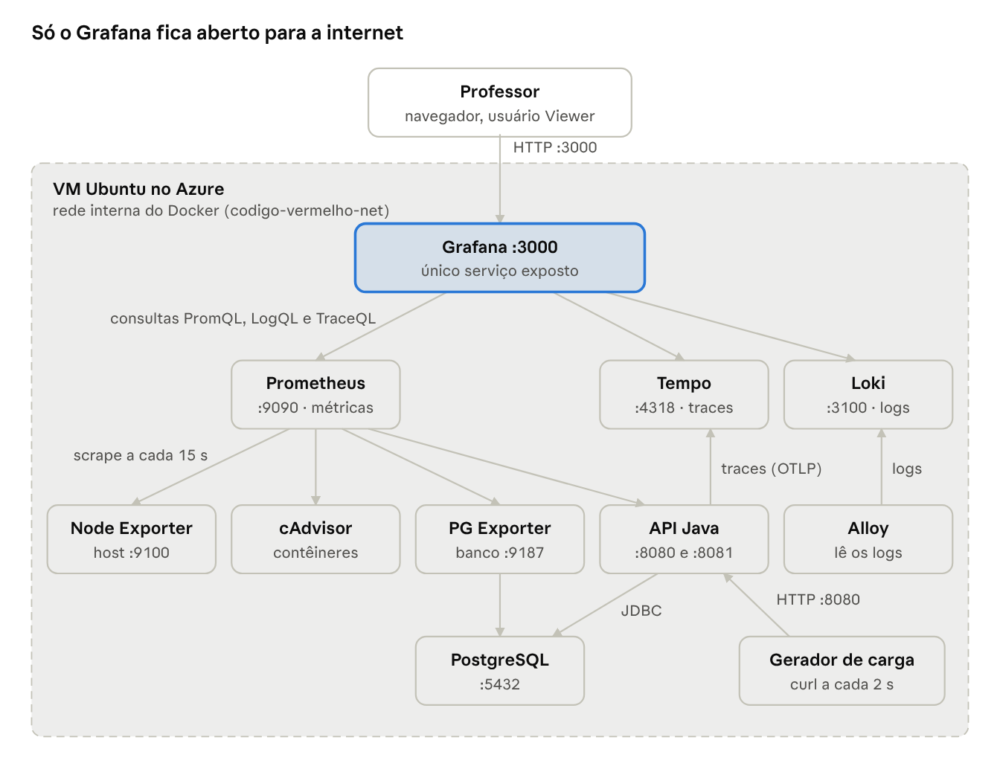

O Prometheus busca as métricas (scrape) na API, pela porta interna 8081, e nos três exporters. A API envia os traces ao Tempo, e o Alloy lê os logs de todos os contêineres e envia ao Loki. O Grafana consulta os três e é o único serviço com porta aberta para a internet; o resto só conversa pela rede interna do Docker.

## 3. Stack utilizada

Usamos a stack padrão do enunciado, **Prometheus + Grafana**, então não houve troca do componente de coleta. Todos os serviços sobem com um único `docker compose up -d --build`, a partir do arquivo `compose.yaml` na raiz do repositório.

| Função | Ferramenta e versão |
| --- | --- |
| Coleta e armazenamento de métricas | Prometheus v2.54.1 |
| Visualização | Grafana 11.2.0 |
| Métricas do host | Node Exporter v1.8.2 |
| Métricas dos contêineres | cAdvisor v0.49.1 |
| Métricas do banco (opcional do R3) | postgres_exporter v0.15.0 |
| Logs | Grafana Loki 3.3.2, com coleta pelo Grafana Alloy v1.5.1 |
| Traces | Grafana Tempo 2.6.1, recebendo por OTLP |
| Gerador de carga | script em shell num contêiner `curlimages/curl` |

Os datasources (Prometheus, Loki e Tempo) e os dois dashboards são provisionados automaticamente pelos arquivos em `grafana/provisioning` e `grafana/dashboards`, sem nenhuma configuração manual no Grafana.

Escolhemos o Alloy para os logs porque ele lê a saída dos contêineres direto pelo Docker, sem precisar mudar o código da aplicação. Como o projeto usa Spring Boot 4, e não o 3.3 do exemplo do enunciado, o tracing foi feito com o `spring-boot-starter-opentelemetry`, que é o caminho dessa versão.

## 4. Métricas de negócio

Criamos seis métricas de negócio com Micrometer, todas na classe [`MetricasNegocio.java`](../../backend/src/main/java/com/codigovermelho/observabilidade/MetricasNegocio.java) e testadas em `MetricasNegocioTest.java`. Cada uma tem um painel próprio na seção "Métricas de negócio" do dashboard de aplicação.

| Métrica no Prometheus | Tipo | O que mede |
| --- | --- | --- |
| `codigovermelho_requisicoes_emitidas_total` | Counter | Requisições de hemocomponente emitidas pelos hospitais, separadas por tipo sanguíneo, componente e urgência (US04) |
| `codigovermelho_requisicoes_pendentes` | Gauge | Requisições que ainda estão com status PENDENTE no banco |
| `codigovermelho_transferencias_criadas_total` | Counter | Transferências de bolsas criadas entre unidades, por componente |
| `codigovermelho_alertas_termicos_total` | Counter | Leituras de temperatura fora da faixa de 2 a 6 °C durante o transporte, separadas em acima e abaixo da faixa (US07) |
| `codigovermelho_rota_calculo_seconds` | Timer | Tempo do cálculo da melhor rota pelo algoritmo de Dijkstra (US05), com p95 e média |
| `codigovermelho_transferencia_criacao_seconds` | Timer | Tempo total para criar uma transferência: validação, cálculo da rota e reserva do estoque |

Os dois timers foram criados com a API de *Observation* do Micrometer. Por isso, além da métrica, cada um aparece como um span nos traces do Tempo.

Trecho de `MetricasNegocio.java` com um exemplo de cada tipo (counter, gauge e timer):

```java
// Counter: requisições emitidas, com tags de tipo sanguíneo, componente e urgência
Counter.builder("codigovermelho.requisicoes.emitidas")
        .description("Total de requisicoes de hemocomponente emitidas pelos hospitais")
        .tag("tipo_sanguineo", rotulo(requisicao.getTipoSanguineo() == null ? null : requisicao.getTipoSanguineo().getLabel()))
        .tag("componente", rotulo(requisicao.getComponente()))
        .tag("urgencia", rotulo(requisicao.getNivelUrgencia()))
        .register(registry)
        .increment();

// Gauge: lido a cada scrape do Prometheus, consulta o banco na hora
Gauge.builder("codigovermelho.requisicoes.pendentes", requisicaoRepository, MetricasNegocio::contarPendentes)
        .description("Requisicoes de hemocomponente aguardando atendimento (status PENDENTE)")
        .strongReference(true)
        .register(registry);

// Timer criado como Observation: vira métrica e também o span "calculo-rota" no trace
return Observation.createNotStarted("codigovermelho.rota.calculo", observationRegistry)
        .contextualName("calculo-rota")
        .highCardinalityKeyValue("rota.origem", String.valueOf(origemId))
        .highCardinalityKeyValue("rota.destino", String.valueOf(destinoId))
        .observe(calculo);
```

As métricas aparecem no Prometheus no print 5.2 e nos painéis do print 5.5.

## 5. Evidências

Todas as evidências foram tiradas do ambiente rodando na VM do Azure. Nos gráficos, o intervalo sem dados entre 11h07 e 11h12 corresponde à reinicialização do Docker na VM para corrigir o cAdvisor (seção 7). Nos prints 5.1 e 5.2, o comando `date` mostra o relógio da VM, que fica em UTC (três horas à frente do horário de Brasília); o horário local aparece na barra de tarefas.

### 5.1 Serviços em execução (E3)

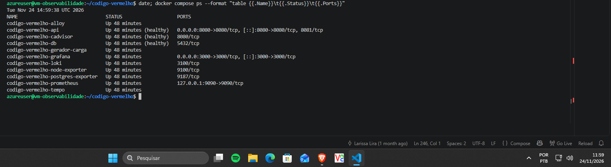

### 5.2 Endpoint `/actuator/prometheus` (E1 e adicional)

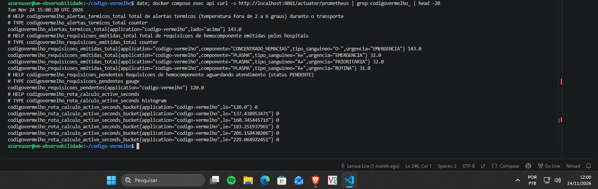

### 5.3 Targets do Prometheus (E2 e E3)

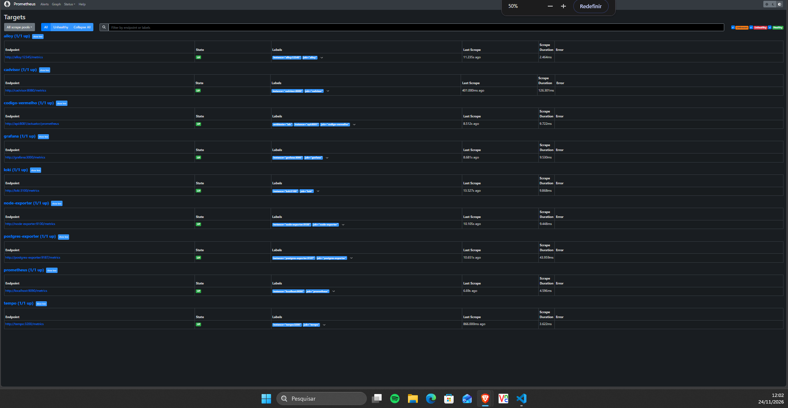

### 5.4 Consulta PromQL (E3)

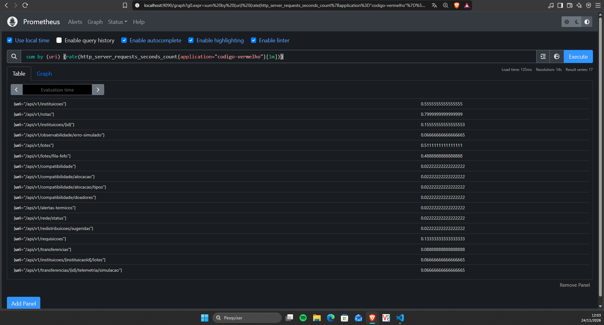

### 5.5 Dashboard de aplicação (E4 e adicional)

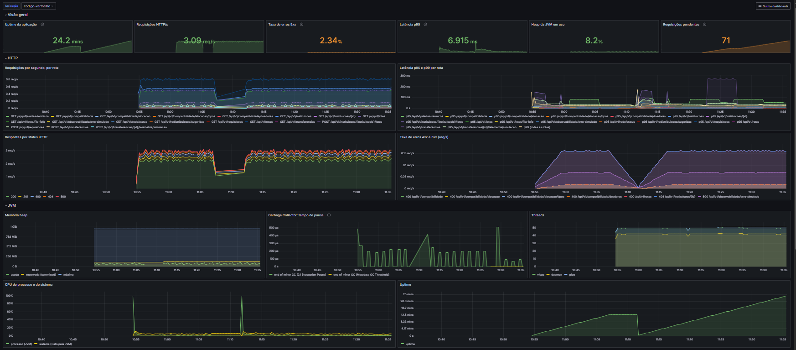

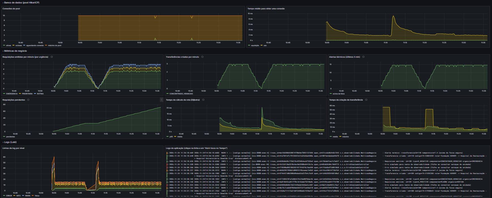

### 5.6 Dashboard de infraestrutura (E4)

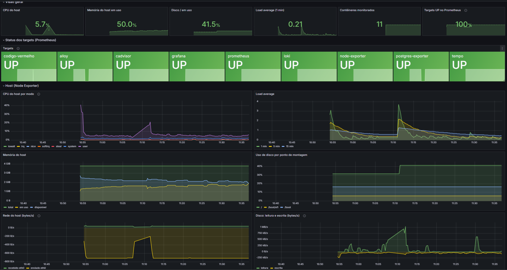

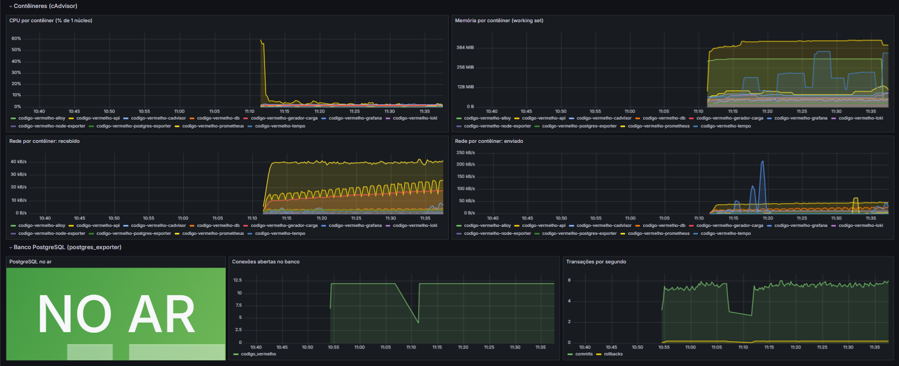

### 5.7 Logs no Loki (E5)

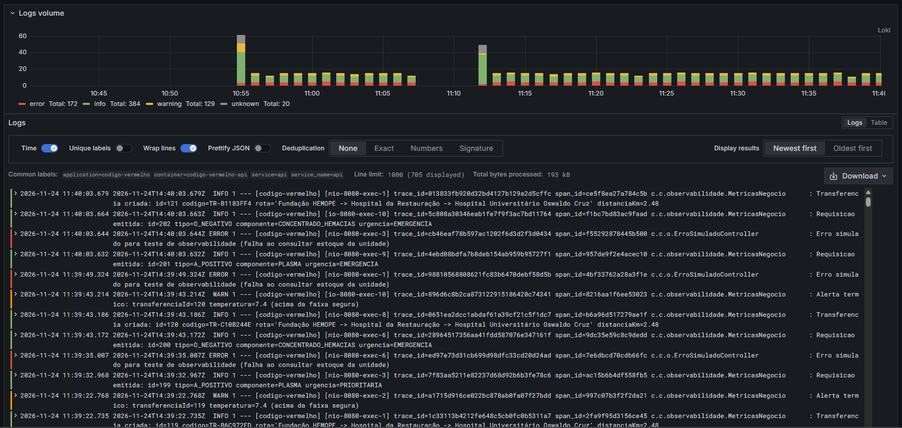

### 5.8 Navegação log → trace (E6)

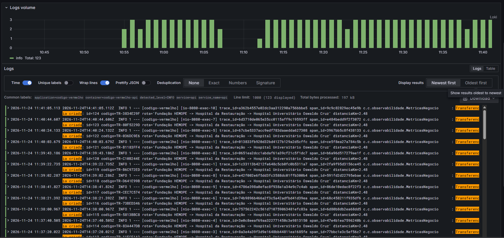

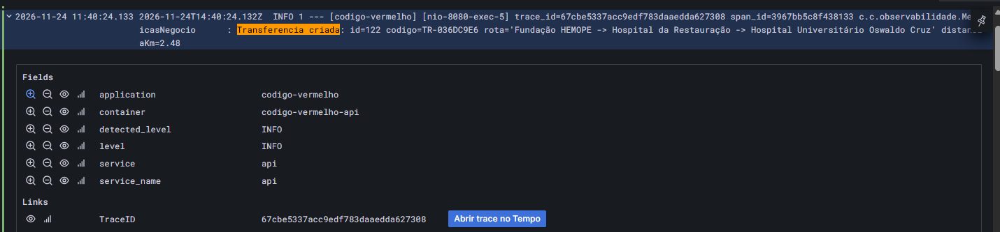

### 5.9 Trace no Tempo (E6)

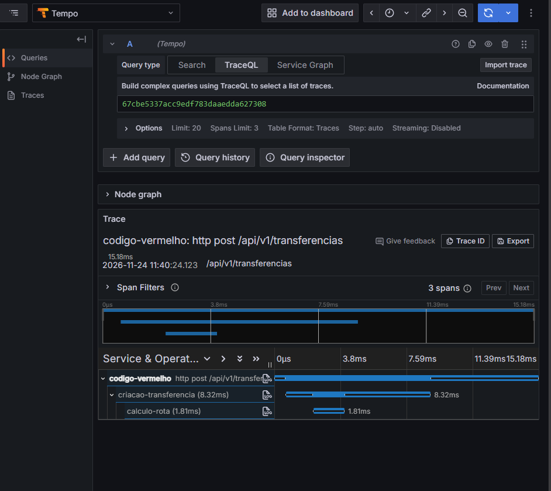

### 5.10 Acesso remoto como professor (E7)

| Logado como professor (Viewer) | Dashboard de aplicação | Dashboard de infraestrutura |
| :---: | :---: | :---: |
| 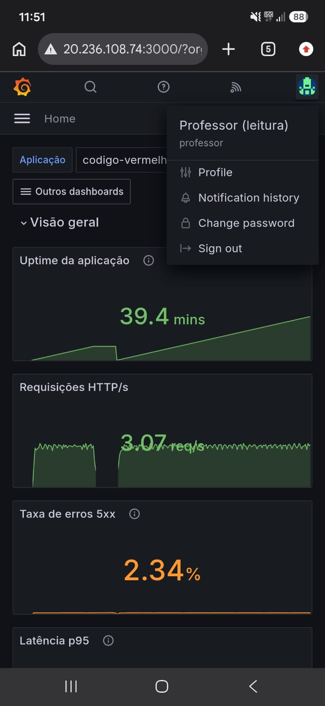 | 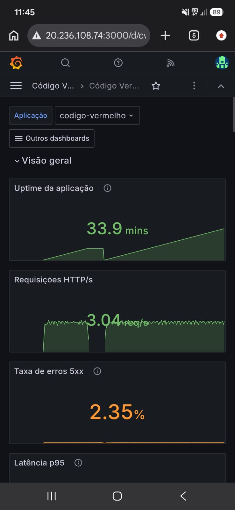 | 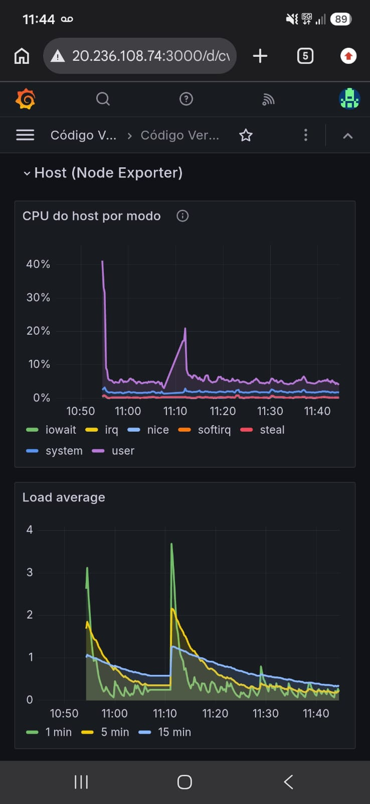 |

## 6. Acesso remoto

O ambiente roda numa máquina virtual Linux no Microsoft Azure, criada com a assinatura gratuita Azure for Students. A VM executa o mesmo `compose.yaml` do repositório, na versão marcada pela tag `rsd-observabilidade-v1`.

| Item | Valor |
| --- | --- |
| URL do Grafana | `http://20.236.108.74:3000` |
| Usuário de leitura (papel Viewer) | `professor` |
| Senha | informada só no PDF entregue no Google Classroom |
| Período disponível | 24/11/2026 a 31/12/2026, 24 horas por dia |
| Máquina | Ubuntu Server 24.04, tamanho B2als_v2 (2 vCPUs, 4 GB de memória), região North Central US |

**Por que escolhemos uma VM:** o professor vai acessar de casa, no horário que preferir. Precisávamos de um ambiente ligado o tempo todo e com um endereço fixo. Um notebook da equipe não ficaria ligado durante dias, e o túnel gratuito do Cloudflare muda de endereço a cada reinício. Na VM, o IP público é estático.

**Segurança do acesso:**

- No firewall da VM (grupo de segurança de rede do Azure), só duas portas estão abertas: 22, para a equipe administrar a máquina por SSH, e 3000, para o Grafana. As portas do Prometheus (9090), do Actuator (8081) e da API (8080) ficam bloqueadas para a internet.
- O usuário `professor` tem papel Viewer: vê os dashboards, mas não consegue editar nada.
- A senha do administrador do Grafana foi trocada e fica no arquivo `.env`, que não vai para o repositório. No GitHub existe só o `.env.example`, sem segredos reais.
- O cadastro público e o acesso anônimo do Grafana estão desligados.

O gerador de carga fica rodando dentro da VM, então os gráficos têm dados no momento em que o professor acessar. Como limitação, o acesso é feito por HTTP, sem HTTPS, por isso o navegador mostra o aviso "Não seguro".

## 7. Dificuldades encontradas e lições aprendidas

A primeira dificuldade foi a versão do Spring Boot. O exemplo do enunciado usa a 3.3.5, mas o nosso projeto já estava na 4.1.1, em que a configuração de tracing mudou. Precisamos usar o `spring-boot-starter-opentelemetry` e excluir dele o envio de métricas por OTLP, porque as métricas já são coletadas pelo Prometheus. Como a entrega ficou no repositório do Projeto Integrador, também deixamos o envio de traces desligado por padrão, para não afetar o deploy no Render.

No Azure, a assinatura de estudante só permite criar recursos em algumas regiões. A primeira tentativa, na East US, foi bloqueada por uma política da Microsoft. Descobrimos as regiões permitidas na política "Allowed resource deployment regions" e usamos a North Central US, onde também havia um tamanho de máquina mais barato disponível.

Na primeira subida, a API não conectava no banco, com o erro *password authentication failed*. O PostgreSQL tinha sido criado com uma senha antiga, porque ele grava a senha só na primeira inicialização. Resolvemos recriando o volume do banco depois de definir as senhas no `.env`.

Por último, os painéis de contêineres ficaram sem dados. Pelo log do cAdvisor, vimos que o Docker 29, instalado na VM, usa por padrão um novo formato de armazenamento (containerd image store) que o cAdvisor v0.49.1 não reconhece. Voltamos o Docker da VM para o armazenamento `overlay2` e os painéis passaram a mostrar os dados.

Como lições, aprendemos que ler os logs de cada serviço é o caminho mais rápido para achar a causa de um problema, e que separar a aplicação da observabilidade (branch própria, pull request com CI e tag da versão avaliada) permitiu trabalhar no repositório do PI sem atrapalhar o resto da equipe. Também ficou claro como métricas, logs e traces se complementam: as métricas mostram que algo mudou, os logs mostram o que aconteceu e o trace mostra onde o tempo foi gasto.
