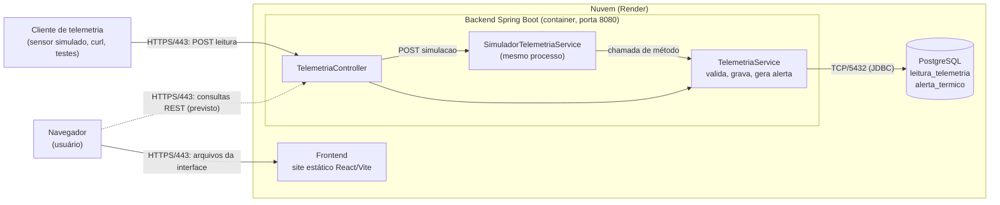
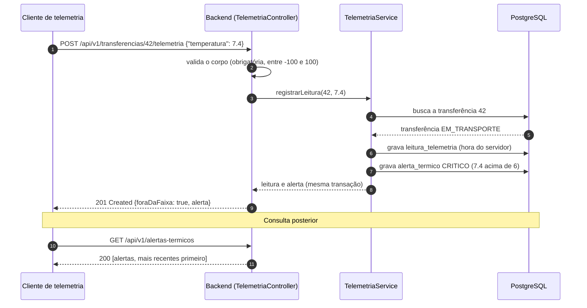

# Validação do Fluxo de Dados entre Aplicação e Telemetria

**Projeto:** Código Vermelho (Rota Vital) · **Disciplina:** Infraestrutura de Comunicação (RSD) · **Histórias:** US07 (telemetria e alertas térmicos) e US10 (monitoramento de rede)
**Base da conferência:** repositório `codigo-vermelho`, branch `main`, commit `91ac764`, conferido em 26/10/2026
**Documentos relacionados:** `arquitetura-codigo-vermelho.pdf` e `.drawio` (arquitetura de rede), `docs/poo/CONTRATOS_API.md` (contratos de API), `METRICAS-E-METODOLOGIA-TESTES-REDE.md` (testes de rede)

---

## 1. Objetivo, método e resultado

Este documento confere **o percurso de uma leitura de temperatura**, desde o envio até o armazenamento, o alerta e a consulta, e compara cada ponto de comunicação com a arquitetura de rede definida.

**Método.** Foram lidos o backend (controllers, services, models, repositories, configurações e testes), o frontend (cliente de API e telas), o `compose.yaml`, o `Dockerfile`, os documentos de deploy e os contratos de API. Cada salto do fluxo foi seguido no código e comparado com o diagrama e com as tabelas de protocolos e redes. O backend não foi executado nesta conferência; as evidências são a leitura do código e os testes automatizados existentes (`TelemetriaServiceTest`, `RotasETelemetriaHttpTest`).

**Resultado em cinco linhas**

1. O caminho **leitura → validação → gravação → alerta → consulta** está completo e testado no backend (5 endpoints da US07).
2. A regra de negócio confere com a história: faixa segura de 2 a 6 °C, leitura fora da faixa é aceita (201) e gera alerta crítico na mesma transação.
3. Os saltos **Backend → PostgreSQL (TCP/5432)** e **Navegador → Frontend (HTTPS/443)** conferem com a arquitetura.
4. O salto **Frontend → Backend (HTTP/1.1, 8080)** do diagrama não corresponde ao fluxo real: o frontend é um site estático e é o **navegador** que chama a API diretamente.
5. A telemetria ainda não chega às telas, e o painel de rede (`GET /api/v1/rede/status`, US10) não existe no backend. Esses dois pontos fecham o fluxo de ponta a ponta.

---

## 2. Percurso dos dados

### 2.1 Visão geral

Linha contínua: ligação implementada. Linha tracejada: ligação prevista, ainda sem implementação.



### 2.2 Passo a passo de uma leitura

| Passo | Onde | O que acontece | Evidência |
|---|---|---|---|
| 1 | Cliente de telemetria | Envia `POST /api/v1/transferencias/{id}/telemetria` com `{"temperatura": 7.4}` | `TelemetriaController.registrar` |
| 2 | Borda (HTTPS/443) e container (8080) | A conexão chega pelo HTTPS na borda e o Spring Boot atende na porta 8080 | `Dockerfile` (`EXPOSE 8080`), `RENDER_SETUP.md` |
| 3 | `TelemetriaController` | Valida o corpo: temperatura obrigatória, entre -100 e 100. Inválida devolve 400 | `NovaLeituraRequest`, `GlobalExceptionHandler` |
| 4 | `TelemetriaService` | Busca a transferência. Não existe: 404 | `buscarTransferencia` |
| 5 | `TelemetriaService` | Só aceita leitura de transferência `EM_TRANSPORTE`. Entregue ou cancelada: 409 | `registrarLeitura`, `Transferencia.isEmTransporte` |
| 6 | PostgreSQL (TCP/5432) | Grava a leitura em `leitura_telemetria`. A hora (`dataHora`) é definida pelo servidor | `LeituraTelemetria` (`@PrePersist`) |
| 7 | `TelemetriaService` | Se a temperatura for menor que 2 ou maior que 6, grava um alerta `CRITICO` em `alerta_termico` na mesma transação | `AlertaTermico`, `@Transactional` |
| 8 | Resposta | `201 Created` com a leitura, `foraDaFaixa` e, quando houver, o alerta | `LeituraResponse` |
| 9 | Consulta | `GET .../telemetria` (histórico em ordem cronológica), `GET .../alertas` (por transferência) e `GET /api/v1/alertas-termicos` (todos) | `TelemetriaController` |

**Fonte simulada.** `POST /api/v1/transferencias/{id}/telemetria/simulacao?quantidade=5&comDesvio=true` gera de 1 a 50 leituras dentro do próprio backend e as envia ao mesmo `TelemetriaService`, então a regra de alerta é idêntica. Esse caminho **não atravessa a rede** entre sensor e servidor. Quantidade fora de 1 a 50 devolve 400.

**Ciclo de vida da transferência.** `POST /api/v1/transferencias` cria a transferência já `EM_TRANSPORTE`, e `PATCH /api/v1/transferencias/{id}/entrega` a marca como `ENTREGUE`. Depois disso o `POST` de telemetria devolve 409.

### 2.3 Sequência de uma leitura fora da faixa



### 2.4 Dados que trafegam

| Etapa | Campos |
|---|---|
| Entrada (`NovaLeituraRequest`) | `temperatura` (número, de -100 a 100). A hora não vem no corpo |
| Gravado (`leitura_telemetria`) | `id`, `transferencia_id`, `temperatura`, `dataHora` (servidor) |
| Gravado (`alerta_termico`) | `id`, `transferencia_id`, `leitura_id`, `temperatura`, `nivel` (`CRITICO`), `mensagem`, `dataHora` |
| Saída do `POST` (`LeituraResponse`) | `id`, `transferenciaId`, `temperatura`, `dataHora`, `foraDaFaixa`, `alerta` (preenchido só quando há alerta) |
| Saída do histórico | Mesma estrutura, com `alerta` sempre `null`. Os alertas são consultados nos endpoints de alertas |

---

## 3. Pontos de comunicação

| # | Origem | Destino | Protocolo e porta | O que trafega | Situação |
|---|---|---|---|---|---|
| 1 | Cliente de telemetria (sensor simulado ou cliente HTTP) | Backend | HTTPS/443 na borda; HTTP/1.1 na 8080 no container | `POST` da leitura; resposta 201 com leitura e alerta | Implementado e testado |
| 2 | `SimuladorTelemetriaService` | `TelemetriaService` | Chamada de método, mesmo processo (sem rede) | De 1 a 50 leituras geradas | Implementado e testado |
| 3 | Navegador | Frontend (site estático) | HTTPS/443 | Arquivos HTML, JS e CSS da interface | Implementado (deploy no Render) |
| 4 | Navegador | Backend | HTTPS/443 em produção; `http://localhost:8080` no desenvolvimento; CORS | Consultas REST (`VITE_API_BASE_URL`) | Parcial: nenhuma tela consome telemetria hoje |
| 5 | Backend | PostgreSQL | TCP/5432 (JDBC) no perfil `prod` e no Compose; H2 em memória no perfil `dev` (sem rede) | Gravação de leituras e alertas; consultas de histórico | Implementado |

---

## 4. Integração com a arquitetura de rede

Comparação entre o que o diagrama e as tabelas entregues afirmam e o que o código e o deploy fazem.

| Item | Arquitetura definida (PDF e drawio) | Código e deploy | Situação |
|---|---|---|---|
| HTTPS na borda | Navegador → Frontend, HTTPS/443 | Frontend publicado como site estático no Render, em URL `https` | Coerente |
| Frontend → Backend | Seta HTTP/1.1, porta 8080, de servidor para servidor | O frontend é um site estático. Quem chama a API é o navegador, com `fetch` para `VITE_API_BASE_URL`, e o backend libera a origem do frontend por CORS | Diverge |
| Backend → PostgreSQL | TCP/5432 (JDBC) | `application-prod.properties` usa `jdbc:postgresql://...:5432`; no Render é usada a *Internal Database URL* | Coerente |
| Banco fora da internet | `sub-dados-a` aceita entrada só de `10.0.10.0/24`, sem saída | No Compose o serviço `db` não publica porta. No Render o banco usa a URL interna, e o acesso externo precisa ser conferido no painel do Render | Parcial |
| Sub-redes e VPC | VPC `10.0.0.0/16` com três sub-redes (pública, aplicação, dados) | O Render é gerenciado e não expõe sub-redes configuráveis. A VPC é a arquitetura-alvo projetada, como pede o enunciado | Arquitetura-alvo |
| Origem da telemetria | Não aparece como componente. Uma nota diz que a telemetria usa o mesmo caminho | Cliente HTTP externo ou simulador interno (sem salto de rede) | A representar no diagrama |
| Painel de rede (US10) | `GET /api/v1/rede/status` documentado | Não existe no backend, o `pom.xml` não tem Actuator e a tela de monitoramento usa dados de exemplo | Não implementado |

**Consequências para o diagrama.** Em produção os caminhos reais são três: navegador → site estático (HTTPS/443), navegador → API (HTTPS/443, com CORS) e API → PostgreSQL (TCP/5432). A seta "Frontend → Backend, HTTP/1.1, 8080" só existiria se houvesse um servidor de frontend (por exemplo, Nginx fazendo proxy reverso da API), o que não é o caso hoje.

---

## 5. Checklist de validação

Resultado: **Validado** (conferido no código e coberto por teste automatizado), **Parcial** (existe, mas com ressalva) ou **Não implementado**.

| ID | Verificação | Resultado | Evidência |
|---|---|---|---|
| V01 | Leitura dentro da faixa devolve 201, sem alerta | Validado | `leituraDentroDaFaixaVolta201SemAlerta` |
| V02 | Leitura acima de 6 ou abaixo de 2 devolve 201 e gera alerta crítico consultável | Validado | `leituraForaDaFaixaVolta201ComAlertaCriticoEFicaConsultavel`, `leituraAbaixoDaFaixaTambemGeraAlerta` |
| V03 | Os limites 2 e 6 são aceitos sem alerta | Validado | `limitesDe2e6SaoAceitosSemAlerta` |
| V04 | Corpo inválido (ausente, texto, acima de 100, abaixo de -100) devolve 400 | Validado | `leituraInvalidaVolta400` |
| V05 | Transferência inexistente devolve 404 no `POST` e nos `GET` | Validado | `transferenciaInexistenteVolta404NasConsultasENoPost` |
| V06 | Transferência que não está em transporte devolve 409 | Validado | `naoAceitaLeituraDeCargaJaEntregue`, `GlobalExceptionHandler` |
| V07 | Leitura e alerta são gravados na mesma transação | Validado | `@Transactional` em `registrarLeitura` |
| V08 | Histórico em ordem cronológica; alertas do mais recente ao mais antigo | Validado | `historicoFicaEmOrdemEOsAlertasSoVemDasLeiturasForaDaFaixa` |
| V09 | A hora da leitura é definida pelo servidor | Parcial | `@PrePersist` em `LeituraTelemetria` (sem fuso horário); o `ENDPOINTS-REST-MVP.md` ainda descreve `timestamp` no corpo |
| V10 | O simulador usa o mesmo caminho do sensor e limita a quantidade a 1 a 50 | Validado | `simuladorSemDesvioNaoGeraAlerta`, `simuladorComDesvioGeraUmAlertaNaUltimaLeitura`, `simuladorRecusaQuantidadeInvalida` |
| V11 | Persistência em PostgreSQL em produção e H2 em desenvolvimento | Validado | `application-prod.properties`, `application-dev.properties` |
| V12 | O navegador consegue chamar a API em produção (CORS) | Parcial | `CorsConfig`; o padrão do perfil `prod` é `http://localhost:5173`, então `APP_CORS_ALLOWED_ORIGINS` precisa apontar para o site do Render |
| V13 | O frontend consome telemetria e alertas do backend | Não implementado | `buscarTelemetriaApi` aponta para `/telemetria` (rota que não existe) e não é usada; Transferências usam `localStorage`; a Central de Alertas usa uma lista fixa |
| V14 | O alerta chega ao operador sem ação manual | Parcial | O alerta é gravado na hora, mas a entrega depende de consulta (polling REST); não há WebSocket nem SSE |
| V15 | Painel de rede com latência, vazão, taxa de erro e uptime (US10) | Não implementado | Sem `RedeController`, sem Actuator; `MonitoramentoRede.tsx` usa `LATENCY_24H` e `SERVICES` de exemplo, com uptime fixo em 99,7 |
| V16 | Contrato de API da US07 coincide com o código | Validado | Os 5 endpoints de `CONTRATOS_API.md` existem no `TelemetriaController` |

---

## 6. Situação das histórias no fluxo

| História | Backend | Frontend | Rede e monitoramento |
|---|---|---|---|
| US07 (telemetria e alertas) | Completo e testado | Sem integração | Falta representar a origem da telemetria no diagrama |
| US10 (monitoramento de rede) | Não implementado | Tela com dados de exemplo | Endpoint e coleta de métricas pendentes |

---

## 7. Ajustes recomendados

Em ordem de prioridade para fechar o fluxo de ponta a ponta.

| # | Ajuste | Onde |
|---|---|---|
| 1 | Atualizar o diagrama e o PDF: incluir a seta navegador → API (HTTPS/443, CORS), rever a seta "Frontend → Backend 8080" e acrescentar a origem da telemetria (cliente simulado) com seta HTTPS/443 para o backend | RSD |
| 2 | Corrigir o `ENDPOINTS-REST-MVP.md`: o `POST` de telemetria recebe só `temperatura` e devolve 201, 400, 404 ou 409; incluir `GET /transferencias/{id}/alertas`, `GET /alertas-termicos` e `POST /transferencias/{id}/telemetria/simulacao`; incluir também `POST /transferencias` e `PATCH /transferencias/{id}/entrega` | RSD |
| 3 | Implementar `GET /api/v1/rede/status` (ou Actuator com Micrometer) e ligar a tela de Monitoramento de Rede a ele | RSD com POO e frontend |
| 4 | Ligar as telas de Transferências e Central de Alertas aos endpoints de telemetria e de alertas, e corrigir a rota de `buscarTelemetriaApi` | Frontend |
| 5 | Conferir no Render a variável `APP_CORS_ALLOWED_ORIGINS` e se o banco aceita conexão externa | SO e RSD |
| 6 | Decidir se a hora da leitura vem do sensor (com fuso) ou do servidor; para sensores reais, a hora do servidor esconde o atraso de entrega | POO e RSD |

---

## 8. Como repetir a validação

Roteiro com `curl` no ambiente local (`./mvnw spring-boot:run`, perfil `dev`, banco H2 com dados de exemplo). Para produção, troque `API` pela URL do backend no Render.

```bash
API=http://localhost:8080/api/v1

# 1. conferir os ids das instituições de exemplo
curl -s $API/instituicoes

# 2. criar a transferência (nasce EM_TRANSPORTE); anotar o "id" da resposta
curl -s -X POST $API/transferencias -H 'Content-Type: application/json' \
  -d '{"origemId":2,"destinoId":3,"tipoSanguineo":"O-","componente":"PLASMA","quantidade":1}'

ID=1   # id da transferência criada

# 3. leitura dentro da faixa: esperado 201, foraDaFaixa=false, alerta=null
curl -s -i -X POST $API/transferencias/$ID/telemetria \
  -H 'Content-Type: application/json' -d '{"temperatura":4.2}'

# 4. leitura fora da faixa: esperado 201, foraDaFaixa=true e alerta CRITICO
curl -s -i -X POST $API/transferencias/$ID/telemetria \
  -H 'Content-Type: application/json' -d '{"temperatura":7.4}'

# 5. consultas: histórico, alertas da transferência e todos os alertas
curl -s $API/transferencias/$ID/telemetria
curl -s $API/transferencias/$ID/alertas
curl -s $API/alertas-termicos

# 6. casos negativos: corpo inválido (400) e transferência inexistente (404)
curl -s -o /dev/null -w "%{http_code}\n" -X POST $API/transferencias/$ID/telemetria \
  -H 'Content-Type: application/json' -d '{"temperatura":150}'
curl -s -o /dev/null -w "%{http_code}\n" -X POST $API/transferencias/999999/telemetria \
  -H 'Content-Type: application/json' -d '{"temperatura":4}'

# 7. fonte simulada: 5 leituras, a última fora da faixa
curl -s -X POST "$API/transferencias/$ID/telemetria/simulacao?quantidade=5&comDesvio=true"

# 8. entregar a carga e confirmar que a telemetria é recusada (409)
curl -s -X PATCH $API/transferencias/$ID/entrega
curl -s -o /dev/null -w "%{http_code}\n" -X POST $API/transferencias/$ID/telemetria \
  -H 'Content-Type: application/json' -d '{"temperatura":4}'
```

Para medir o percurso com tempos (DNS, TCP, TLS e resposta), use os comandos do apêndice de `METRICAS-E-METODOLOGIA-TESTES-REDE.md`.
